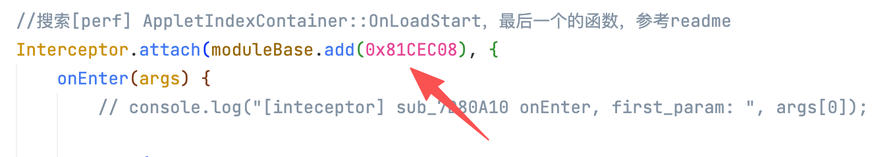
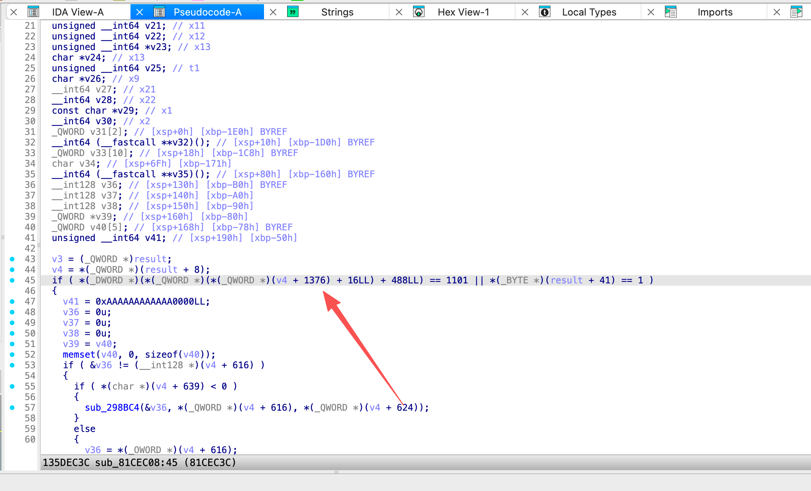
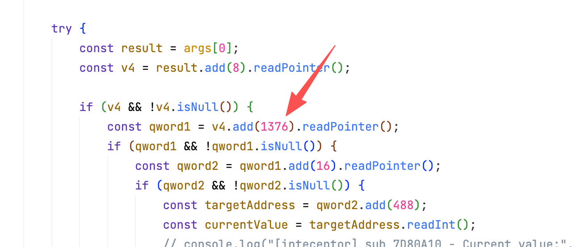

# WMPFDebugger-arm

感谢上游开源：https://github.com/evi0s/WMPFDebugger

## 原生 Network 协议模式

> **验收状态：协议回归与隔离 Chrome 测试通过，25800 实机 XHR 尚未通过。**
> 已收到原生调试流，但本轮实机未收到请求起始事件，不能称为“Network 已修好”。
> 注入默认受保护；未证实有效的提前激活、过滤器旁路默认关闭。
> 实机观察和剩余问题见 [docs/native-runtime-status.md](docs/native-runtime-status.md)。

**不用抓包代理、不装证书、不包装 `wx.request`。** 仅把微信原生 LanDebug
消息适配给 Chrome DevTools，不改变小程序的业务网络路径。

支持 `customMessage/__networkDebug`、`chromeDevtoolsResult`、
`domEvent/DEBUGGEE_EVENT`；响应体按来源使用对应的原生取回命令。
不会轮询 JS、补发业务请求或伪造 Network 事件。详细协议和证据见
[docs/native-protocol.md](docs/native-protocol.md)。

```bash
npm ci                     # 或 yarn install
npm test                   # 25 项本地回归，不注入微信
npm run typecheck
npm run test:ui             # 隔离 Chrome + 协议测试数据，不是实机请求
npm run relay              # 只启动原生协议适配，不需要 sudo
```

调试器地址：
```
devtools://devtools/bundled/inspector.html?ws=127.0.0.1:62000
```
只读状态：`http://127.0.0.1:62000/status`。状态为 `connected=false` 时，
微信运行时没有连上，不代表 Network 已可用。

**注意：单独启动 relay 不能让普通微信自动进入调试模式。** 必须有已经启用
LanDebug 的运行时连接 9421。当前目标是微信 **4.1.15 / WeChatAppEx 7.25800
(macOS arm64)**，native hook 配置在 `config/addresses.25800.darwin.json`。
该版本曾在旧 Frida 17.3.2 下发生注入超时/卡死；现已锁定 17.24.3，
通过独立 C 测试进程的三轮加载/挂钩/卸载，但实机稳定性仍须单独验证。
因此普通的 `src/index.ts` 启动仍阻止 25800 注入，不会自动追踪新 PID。

仅用于明确选择的一次实验验证（不要与独立 relay 同时占用端口）：
```bash
npm run test:frida
sudo env PATH=/usr/local/bin:/usr/bin:/usr/sbin:/bin:/sbin \
  npx ts-node src/index.ts --experimental-25800 --pid <WeChatAppEx主进程PID> --session-seconds 90
```
只接受真实的 WeChatAppEx 主进程，不附加 shell、WeApp/Renderer 或微信主程序。
加载及卸载有超时；必须收到 `wmpf-ready` 才报告挂钩成功。
`--session-seconds` 到期自动卸载退出。请勿把本地模拟测试通过视为实机 Network 验证通过。

## 换新版本（无需 IDA）

```bash
python3 -m pip install capstone numpy
python3 scripts/find-offsets.py      # 1~2 秒扫完 184MB __TEXT，输出 tailGate/工厂/资源缓存候选
```

把结果人工复核后写成 `config/addresses.<WMPF版本>.darwin.json`
（WMPF 版本 = `WeChatAppEx.app` 的 `CFBundleVersion` 尾段，如 7.25800 → 25800）。
详细推导与各版本偏移见 [ADAPTATION.md](ADAPTATION.md) §8/§14。

## 不同版本偏移查找（老方法：IDA）

ida arm打开（时间很久 要等）
```
cd '/Applications/WeChat.app/Contents/MacOS/WeChatAppEx.app/Contents/Frameworks/WeChatAppEx Framework.framework/Versions/C'
```
## 搜索[perf] AppletIndexContainer::OnLoadStart

修改为这个地方的偏移

## 上个函数的最后调用的函数


不通版本这个位置偏移不同


这个值设置为1101


## 搜索SendToClientFilter

这个函数的
```
if ( v8[2] != 6 )
```
这个判断要为true，v8[2]的值不为6

## 搜索WAPCAdapterAppIndex.js
第一个引用

直接返回0x0